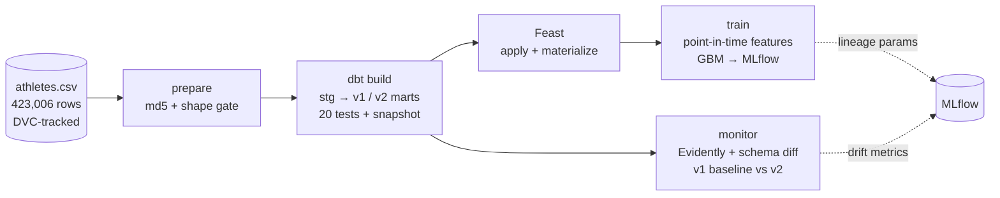

# athletes-mlops-pipeline

> raw CSV → **DVC** → **dbt** (DuckDB) → **Feast** → **MLflow** (data + transformation lineage) → **Evidently** drift report, orchestrated by one **Airflow** DAG.


-00aa55?style=flat-square&labelColor=2a323d)


Four course assignments (DVC/Git-LFS versioning, a dbt project, a Feast feature store with MLflow, model
monitoring) used to be four notebooks on three different datasets, and the feature-store assignment re-cleaned the
data from scratch. This repo wires them into **one reproducible pipeline over one dataset**: the 423,006-row CrossFit
Games athlete export. The question the model answers is deliberately simple (predict an athlete's `total_lift`) so the
engineering is the point.



The same five stages exist twice on purpose: `dvc.yaml` (reproducibility, caching) and
`airflow/dags/athletes_pipeline.py` (scheduling, retries, UI). Each Airflow task runs the command of the matching DVC stage.

**Verified end to end.** `airflow dags test athletes_mlops_pipeline` inside the Docker image (Airflow 2.10.5, project
dependencies in their own virtualenv) ran all five tasks to success on 2026-10-25 (about 30 seconds), logging one
training run and one monitoring run to MLflow. `dvc repro` on the host gives the same metrics (RMSE 142.47).

## What each tool owns

| Layer | Tool | Responsibility |
|---|---|---|
| Data versions | DVC | The raw file is content-addressed (`data/raw/athletes.csv.dvc`); every stage's inputs and outputs are hashed in `dvc.lock` |
| Cleaning | dbt on DuckDB | The only place cleaning rules live: typed staging, `athletes_v1` (28 columns) and `athletes_v2` (cleaned + features), tests, snapshot, schema diff |
| Features | Feast | Offline source = the parquet dbt writes, so nothing is re-cleaned; point-in-time retrieval for training, online store for serving |
| Training | scikit-learn + MLflow | `HistGradientBoostingRegressor` against a mean baseline; the run records the data and transformation versions |
| Monitoring | Evidently + dbt | Schema drift between v1 and v2 and distribution drift on the shared columns |
| Orchestration | Airflow (Docker) | `prepare → dbt_run → feast_materialize → train → monitor` |

## Results

| | |
|---|---|
| raw rows | 423,006 |
| v1 (any row with all four lifts) | 85,191 rows × 28 columns |
| v2 (cleaned, modelling-ready) | 30,147 rows × 19 columns (+ `athlete_id` as the entity key) |
| train / test | 24,117 / 6,030 (`random_state=42`) |
| RMSE | **142.5 lb** vs 281.7 lb for predicting the mean (**−49.4 %**) |
| MAE / R² | 107.3 lb / 0.744 |

**The SQL reproduces the notebook exactly.** `tests/test_parity.py` rebuilds v1 and v2 with the original pandas code
(`src/reference_clean.py`) and asserts value-for-value equality with the dbt output, and a dbt test pins the row counts.

### Lineage: what one MLflow run records

Every training run carries these parameters, so a model can be traced to the exact data and code that produced it:

| Param | Meaning |
|---|---|
| `lineage.dvc_raw_md5` | DVC hash of the raw CSV |
| `lineage.dbt_models_sha256` | hash of every dbt model and schema file |
| `lineage.dbt_invocation_id`, `dbt_version`, `dbt_tests_passed/failed` | the dbt run that produced the features |
| `lineage.features_v2_sha256` | hash of the feature parquet Feast served |
| `lineage.feast_registry_sha256`, `feast_feature_service` | the feature definitions used |
| `lineage.git_sha` | code version |

### Monitoring findings (v1 → v2)

* **Schema drift is large and explained:** 4 columns added (`age_group`, `bmi`, `height_m`, `weight_kg`), 12 dropped
  (`name`, `team`, `affiliate`, workout benchmarks, `train`, …), 16 kept.
* **Distribution drift on the 10 shared columns: 0 flagged** at Evidently's default normalised distance of 0.1.
  That is a limit of the test, not good news: cleaning removed athletes weighing up to **9,008 lb** (max weight
  drops to 474 lb), which a rank-style distance barely sees. The report therefore also lists null rates and extremes.
* **dbt found 10 implausible BMIs** (1.0 to 9.9) that the original notebook never removed. The test is a warning so the
  row counts keep matching the reference; see `dbt_athletes/tests/assert_bmi_plausible.sql`.

## Run it

```bash
make setup                       # Python 3.12 env (uv)
# put the dataset at data/raw/athletes.csv, then:  dvc add data/raw/athletes.csv
make all                         # dvc repro: the whole pipeline from the raw file
make test                        # dbt tests + pandas-vs-SQL parity
make mlflow                      # runs and lineage at http://localhost:5000
make airflow                     # Airflow at http://localhost:8080, then trigger athletes_mlops_pipeline
```

The raw file is 71 MB and is **not** in the repository. `reports/raw_check.json` records the expected md5
(`ade8057a9ad4350dfade9180f021a96d`) and the `prepare` stage refuses to run on any other file.

## Design notes and limits

* **dbt keeps `athlete_id`; the notebook dropped it.** Feast needs an entity key. Three raw rows have no id (all other ids are
  unique), so the feature tables drop rows without an id and keep one row per id.
* **`event_timestamp` is a convention.** The data has no time column, so each schema version gets a date
  (`v1_as_of`, `v2_as_of` in `dbt_project.yml`) and training reads features "as of" a later date.
* **The online store is a demo.** Only v2 is materialised; there is no serving API.
* **Not covered:** retraining triggers, model registry promotion, and alerting on the drift report.

---

Jiawei Liu · MS Applied Data Science, University of Chicago · [LinkedIn](https://www.linkedin.com/in/jiawei-liu-6637122a1/)
